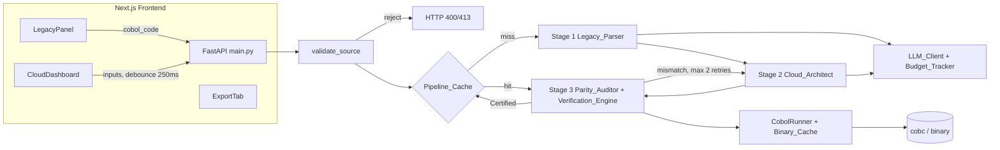

# Design Document

## Overview

The Universal_Platform turns VeriCOBOL into a pipeline that accepts any COBOL program. The Backend removes the preset bypass (`preset_bundles.json`, `reference_models.py`), infers the contract and I/O protocol with a live LLM call, generates exact-Decimal Python, and proves penny parity against real GnuCOBOL on every request. The Frontend becomes an editable workbench with a dynamic dashboard driven by `dashboard_metadata`.

Main design decisions:

- **No runtime bypass.** Starter templates are raw text. Every submission runs the live Pipeline. If the LLM is unavailable the API returns 503 and nothing is served from bundles.
- **Contract inference replaces field schemas.** Legacy_Parser returns `io_protocol`, a Contract_Schema, rules and dashboard metadata in one JSON object.
- **Four I/O protocols** share one Verification_Engine through a protocol adapter that renders input lines and parses stdout.
- **Compile once.** A Binary_Cache (LRU, 16 entries, keyed on SHA-256 of the source) lets slider calls run a binary in under 50 ms.
- **Cache saves tokens, never proof.** Pipeline_Cache stores only Certified LLM stage output. The Parity_Auditor re-runs live GnuCOBOL on every request.
- **Retired artifacts become test oracles.** `preset_bundles.json` and `reference_models.py` stay in the repo, imported only from `backend/tests/`.

### Existing code to change

| Module | Current state | Change |
|---|---|---|
| `llm_client.py` | Prices 0.05/0.40 per 1M tokens, no fence stripping, no `LLM_BUDGET_USD`, `extract_rules` needs a caller schema | New prices (0.10/0.50), env cap, fence stripping, `infer_contract` stage, one validation retry, cause-tagged unavailability |
| `cobol_runner.py` | Per-preset binary cache, `-free` only | `-free` then fixed fallback, SHA-256 LRU of 16, protocol-aware runs |
| `resurrection.py` | `Pipeline` seeded from bundles, schema from preset or caller | Remove `seed_cache`, `load_preset_bundles`, `reference_decimal_source`, `contract_from_preset`; use inferred contract |
| `main.py` | `/api/verify`, `/api/calculate`, `/api/export/{preset_id}` use presets | Add `/api/calculate-custom`, `/api/export-custom`; drop preset-only endpoints; `/health` adds `llm_configured`; map LLM errors to 503/502 |
| `export_template.py` | `render(code, schema)` | Unchanged API; add float-free guarantee check |
| `pipeline_cache.py` | `CachedResult`, `normalize_cobol`, `cache_key`, LRU | Normalize keyword case and comment lines; store only Certified results; empty on start (no seeding) |

## Architecture



Request order for `POST /api/resurrect`:

1. Body size check, JSON parse with `parse_float=Decimal`, request model validation.
2. `validate_source` (400/413). No LLM or compiler call yet.
3. Pipeline_Cache lookup unless `force_live_llm`.
4. On miss: Stage 1, Stage 2. On hit: reuse stored contract, rules and code.
5. Stage 3: compile once, run cases, compare. On mismatch call `repair_python`, at most 2 times.
6. If Certified and the stages came from the live LLM, store in Pipeline_Cache.
7. Build `export_fastapi_code` with `export_template.render()`, return the Resurrect_Response.

## Components and Interfaces

### Backend: `llm_client.py`

```python
BUDGET_CAP_USD = Decimal("2.00")                 # override: LLM_BUDGET_USD
_PRICE_IN  = Decimal("0.10") / Decimal(1_000_000)
_PRICE_OUT = Decimal("0.50") / Decimal(1_000_000)

class LLMUnavailable(Exception):
    cause: Literal["missing_key", "provider_failure", "budget_exhausted"]

class LLMClient:
    @classmethod
    def from_env(cls, tracker=None) -> "LLMClient": ...
    def infer_contract(self, cobol_source: str, validation_error: str | None = None) -> InferredProgram
    def generate_python(self, cobol_source, program, *, float_demo: bool = False) -> ArchitectOutput
    def repair_python(self, cobol_source, program, counterexample, previous_code) -> ArchitectOutput
```

- Only `LLM_BASE_URL`, `LLM_API_KEY`, `LLM_MODEL` are read for the endpoint. `.env.example` sets `LLM_MODEL=gpt-6-luna` and placeholders for the rest. The client never opens `.env`.
- `_extract_json(text)` strips a leading ```` ```json ```` or ```` ``` ```` fence and a trailing fence, then `json.loads(..., parse_float=Decimal)`.
- `LLM_BUDGET_USD` is parsed with `Decimal`. An invalid value falls back to `2.00`.
- `Budget_Tracker.can_spend` is false once spend plus the call estimate reaches the cap. The client then raises `LLMUnavailable("budget_exhausted")`. A missing or placeholder key raises `LLMUnavailable("missing_key")`. A timeout or provider error raises `LLMUnavailable("provider_failure")` after the retry policy.
- All error messages are built from fixed strings. The key and raw provider payload never appear.
- `infer_contract` validates the reply against `InferredProgram`. On a schema or JSON failure it retries once, sending the validation error. A second failure raises `LLMCallError`, mapped to 502.

`InferredProgram` fields: `program_title`, `description`, `io_protocol`, `contract` (inputs and outputs), `business_rules`, `dashboard_metadata`.

### Backend: `cobol_runner.py`

```python
@dataclass(frozen=True)
class CompileResult:
    ok: bool
    binary_path: Path | None
    source_format: Literal["free", "fixed"] | None
    diagnostics: str

class CobolRunner:
    def compile_source(self, source: str, sandbox_dir: Path) -> CompileResult   # free, then fixed
    def get_binary(self, source: str) -> CompileResult                          # Binary_Cache
    def run_batch(self, binary: Path, rows: list[str]) -> RunResult
    def run_single(self, binary: Path, stdin_text: str) -> RunResult
```

- `compile_source` runs `[cobc, "-x", "-free", "-o", out, src]`. If it fails with a syntax error it retries once with `[cobc, "-x", ...]`. If both fail, the diagnostics of the last attempt go to the caller, which returns 400.
- `COBC_PATH` selects the compiler. Every subprocess uses an argument list, a 5 s timeout, and kills the process tree on timeout.
- `BinaryCache` is an `OrderedDict` guarded by a lock, `max_entries=16`, keyed on `sha256(cobol_source)`. Each entry owns a directory made by `tempfile.mkdtemp` (needed because binaries outlive one request). Eviction deletes the directory in `finally`. A shutdown hook clears the rest.
- Stdout is capped (`MAX_OUTPUT_BYTES`). `validate_source` is invoked by the callers in `main.py` and `resurrection.py`, and again inside `get_binary` as defense in depth.
- The rejection list matches Requirement 3: `CALL`, `SYSTEM`, `SELECT ... ASSIGN`, `OPEN`, `READ`, `WRITE`, `REWRITE`, `DELETE`, `COPY`, `REPLACE`, `ACCEPT ... FROM ENVIRONMENT|COMMAND-LINE`, `DISPLAY ... UPON ENVIRONMENT`. Fixed-format lines with `*` in column 7 are comments and are skipped. Errors carry the construct name and line number.

### Backend: `resurrection.py`

```python
class Pipeline:
    def run(self, cobol_code: str, *, num_cases: int = 150,
            demonstrate_self_healing: bool = False,
            force_live_llm: bool = False) -> ResurrectResponse
```

Stages and records:

- `legacy_parser`: `infer_contract`. Enforces Req 5.9 and 5.10 (zero inputs allowed only for `no_input_static`, else 422).
- `cloud_architect`: `generate_python`. In demo mode attempt 1 is a naive float translation.
- `parity_auditor`: calls the Verification_Engine through a protocol adapter and drives `SelfHealingLoop`.

`ProtocolAdapter` (one per `io_protocol`):

| Protocol | Stdin built from a case | Cases | Output parse |
|---|---|---|---|
| `batch_space` | One space-separated line per case, all cases in one process | 150 | One line per case |
| `single_run_lines` | One field per line | 35 to 50 | Labeled or positional stdout lines |
| `single_run_space` | One space-separated line | 35 to 50 | Same |
| `no_input_static` | Empty | 1 | Once, compared to `calculate()` |

`SelfHealingLoop.run`:

1. Attempt 1 uses the architect code. In demo mode it is the float translation, executed with `allow_float_demo=True`, with results converted by `Decimal(str(x))`.
2. If the Parity_Report has a mismatch and retries used < 2, send the first Counterexample to `repair_python` and re-verify.
3. Stop on Certified. After the last retry with a mismatch, return 200 with `certified=false`.
4. Every stage execution and every attempt appends an `AuditRecord`. The Parity_Auditor stage always reports `source="live"`.
5. A generated attempt that contains float constructs (checked by `guard_no_float`) counts as a failed attempt unless it is the float-demo attempt.

Errors: `PipelineStageError(status, stage, body)` stays. LLM exceptions map as `missing_key|provider_failure|budget_exhausted -> 503`, `LLMCallError -> 502`, contract incomplete -> 422.

### Backend: `pipeline_cache.py`

- `normalize_cobol(source)`: normalize line endings, drop comment lines (`*` in column 7 or `*>` leading), collapse whitespace outside literals, uppercase keywords outside literals, strip blank edges. Idempotent.
- `cache_key(source, demonstrate_self_healing)` is SHA-256 of normalized bytes plus a flag byte.
- `PipelineCache` is a thread-safe LRU. `put` is called by the pipeline only for Certified results from the live LLM path. `CachedResult` holds the program inference, rules, dashboard metadata and verified Python. The cache starts empty.
- On a hit the pipeline skips stages 1 and 2 (audit records mark them `source="cache"`), and still runs stage 3 live.

### Backend: `export_template.py`

`render(verified_python_code, schema) -> str` returns a self-contained FastAPI module. It parses the entry point with `ast`, embeds the verified code, declares inputs from the contract, and parses request values as `Decimal` strings. A post-render check (`ast.walk`) rejects any `float` name, float constant or `math.pow` in the output, and raises `ValueError` if found.

### Backend: `main.py`

| Method and path | Purpose | Notes |
|---|---|---|
| `GET /health` | Status | Returns `status`, `cobc_available`, `cobc_version` (cached), `llm_configured: bool`. No LLM or compiler call. |
| `GET /api/presets` | Starter templates | `[{id, title, cobol_code}]`, no contract, results or Python |
| `POST /api/resurrect` | Pipeline | Body: `cobol_code` or `preset_id`, `num_cases`, `demonstrate_self_healing`, `force_live_llm` |
| `POST /api/calculate-custom` | One input set | Runs restricted Python and the cached binary, returns `result`, `raw_cobol_output`, `parity_verified` |
| `POST /api/export-custom` | Download | Returns `filename`, `verified_python_code`, `export_fastapi_code`, `certified` |

`/api/calculate-custom` request: `cobol_code`, `python_code`, `schema`, `io_protocol`, `inputs: dict[str, str]`. Flow: size check, `validate_source` (400), per-field range and PIC capacity check (422 naming the field), `get_binary` from Binary_Cache, run COBOL and restricted Python, compare each output with difference 0.

Shared behavior:
- `BodySizeLimitMiddleware` stays (413). `DecimalJSONResponse` serializes `Decimal` as strings.
- `_JsonFloat` rejection stays for money values. Amounts are strings in new endpoints.
- CORS allows only `FRONTEND_URL`.
- `_warm_presets` is removed. Startup does not compile anything.
- Blocking work runs in `run_in_threadpool` guarded by a lock so a 0.1 CPU instance is not overcommitted.

### Frontend

Under `frontend/src/components/`:

| Component | Role |
|---|---|
| `LegacyPanel/CobolSourceEditor` | Editable textarea, `flex flex-col h-full`, `flex-1` code area, drag-and-drop of `.cbl/.cob/.txt` onto the terminal |
| `LegacyPanel/Toolbar` | Upload button, Clear / Blank, "Bypass Session Cache (Force Live AI)" checkbox, "Load Test Sandbox Attack (CALL SYSTEM)" (uses `lib/sandboxSnippet.ts`) |
| `PresetTabs` | "Starter Templates:" pills plus "+ Custom / Blank"; loads raw text only |
| `PipelineStepper` | Three stages, "3. Parity Auditor" with emerald "live" badge, current stage name while running |
| `CloudDashboard/*` | Sliders and decimal inputs from `dashboard_metadata.inputs`, KPI cards, static-program notice when inputs are empty |
| `CloudDashboard/DynamicChart` | Native SVG, `BigInt` geometry via `lib/chartGeometry.ts`, zero line, flag badges |
| `BusinessRulesAndPicMap`, `ParityBanner` | Rules, PIC map, parity result |
| `VerifiedPythonTab`, Export tab | Show code, copy, download, refresh via `/api/export-custom` |
| `AuditTrail` | `key=value` chips with `whitespace-nowrap`, wrapping between chips |
| `HealthPill`, `ColdStartBanner`, `RejectionDetail` | Status, warm-up text, 400/503 message display |

Hooks: `useResurrect` (pipeline call, stage status, error mapping), `useCalculate` (250 ms debounce, keeps values as strings, posts to `/api/calculate-custom`, publishes stdout to the Legacy_Panel), `useHealth` (pings `/health` on load, formats `cobc (GnuCOBOL) 3.2.0` to `GnuCOBOL 3.2.0 Online`).

`lib/api.ts` reads `NEXT_PUBLIC_API_URL`. `lib/money.ts` and `lib/chartGeometry.ts` use string and `BigInt` arithmetic only, so `npm run check:nofloat` passes.

Theme: containers `bg-[#0F172A]`, cards `bg-[#1E293B]`, borders `border-slate-800|700`, text `text-slate-100|400`. Legacy_Panel keeps `#0A0E0C` and `#00FF66`. `.kiro/steering/frontend-design.md` records the palette.

## Data Models

```python
IOProtocol = Literal["batch_space", "single_run_lines", "single_run_space", "no_input_static"]
OutputFormat = Literal["currency", "percent", "integer", "decimal", "flag", "text"]
ChartType = Literal["bar_comparison", "breakdown", "waterfall", "summary"]

class InputField:   name, label, pic, scale: int, min: Decimal, max: Decimal, step: Decimal
class OutputField:  name, label, pic, scale: int, rounding: Literal["truncate", "rounded"], format: OutputFormat
class ContractSchema: inputs: list[InputField]; outputs: list[OutputField]
class DashboardMetadata: title, chart_type: ChartType, inputs, outputs

class Counterexample:  inputs, cobol_output, python_output, field, likely_cause
class ParityReport:    passed: int, total: int, parity_score: Decimal, counterexamples: list[Counterexample]
class AuditRecord:     stage | attempt, source: "live" | "cache", duration_ms, detail

class ResurrectResponse:
    cobol_code, program_title, description, io_protocol, contract, business_rules,
    dashboard_metadata, verified_python_code, export_fastapi_code,
    parity_report, audit_trail: list[AuditRecord], certified: bool
```

Money values are `Decimal` in the Backend and strings on the wire and in the Frontend (`types.ts`).

## Error Handling

| Condition | Status | Body |
|---|---|---|
| Prohibited construct | 400 | construct, line number; 0 LLM and compiler calls |
| Source over size cap | 413 | size message |
| Compile fails in both formats | 400 | last compiler diagnostics |
| Unknown `preset_id` | 404 | `{error: "unknown_preset", valid_ids}` |
| Input out of range or PIC capacity | 422 | field name |
| Contract has no inputs or no outputs (non-static) | 422 | missing part |
| LLM key missing, provider failure, budget exhausted | 503 | message naming the cause |
| LLM JSON or schema invalid after one retry | 502 | validation error |
| Parity mismatch after 2 retries | 200 | full audit trail, `certified: false` |

Cross-cutting rules: error text never includes API keys or raw provider payloads. Temp directories are removed in `finally`. The Frontend shows the API message for 400 and 503 and renders no results.

## Test, Build and Git Flow

Tests:
- `backend/tests/test_universal_cobol.py` uses a `FakeLLM` that returns scripted `InferredProgram` and `ArchitectOutput` values. No network, no tokens. It uses real `cobc` for: Payroll Tax Calculator (`single_run_lines`), a fixed-format 80-column program, `/api/calculate-custom` and `/api/export-custom`. It also checks the sandbox 400 with 0 LLM calls and the 503 case with no bundle fallback.
- Older tests that expected bundle bypass are rewritten to use `FakeLLM`. `preset_bundles.json` and `reference_models.py` appear only as oracles under `backend/tests/`.
- Property tests use Hypothesis with at least 100 examples, tagged `Feature: universal-open-cobol-platform, Property N`. Optional property sub-tasks in `tasks.md` are skipped per Requirement 23.8.
- Frontend: `npm run check:nofloat`, `npx tsc --noEmit`, `npm run lint`, `npm run build`.

Delivery sequence (each step stops the flow on failure):

1. `docker build -t vericobol-backend ./backend`.
2. Run the full pytest suite in the container, 0 failures.
3. In `frontend/`: `check:nofloat`, `tsc --noEmit`, `lint`, `build`.
4. Smoke: run a temporary container on port 8001, `GET /health`, post a `CALL "SYSTEM"` program and expect 400, confirm responses contain no environment content, then stop and remove the container.
5. Secrets check: `git check-ignore .env` succeeds, `.env.example` holds only placeholders, `git diff --cached --name-only` does not list `.env`. The flow never reads or prints `.env` and stages files by explicit name, never `git add -A`.
6. Update completed checkboxes in `tasks.md`, commit, then push with `GIT_TERMINAL_PROMPT="0"` and `GCM_INTERACTIVE="never"` using `git push origin main`.

## Correctness Properties

*A property is a characteristic or behavior that should hold true across all valid executions of a system. Properties connect human-readable requirements to machine-verifiable guarantees.*

### Property 1: Budget accounting is exact and capped

For any sequence of calls with token counts, the Budget_Tracker's cumulative spend equals the sum of `in*0.10/1e6 + out*0.50/1e6` as `Decimal`, and for any cap, no call is issued once spend plus estimate reaches the cap, with cause `budget_exhausted`.

**Validates: Requirements 1.3, 1.4, 1.5**

### Property 2: Reply parsing strips fences and preserves Decimal

For any JSON object, wrapping its serialization in no fence, a ```` ``` ```` fence or a ```` ```json ```` fence yields the same parsed value, and every non-integer number in the result is a `Decimal`, never a `float`.

**Validates: Requirements 1.6, 1.7**

### Property 3: Errors never leak the key

For any API key string and any failure path (timeout, provider error, malformed reply, budget), no response body, exception message or log record contains the key.

**Validates: Requirements 1.8**

### Property 4: Sandbox validator blocks prohibited constructs on executable lines

For any COBOL program, if an executable line contains a prohibited construct, in free or fixed format, `validate_source` rejects it with that construct and line number. For any program whose only occurrences are in fixed-format comment lines (`*` in column 7), it does not reject.

**Validates: Requirements 3.2, 3.4, 3.5**

### Property 5: Rejected sources reach no LLM and no compiler

For any source rejected by the Sandbox_Validator and any endpoint, the response is 400 and the LLM and compiler call counts stay 0.

**Validates: Requirements 3.1, 3.3**

### Property 6: Binary cache is bounded, LRU, and compile-once

For any sequence of source requests, the Binary_Cache never holds more than 16 entries, evicts the least recently used entry (and deletes its files) when full, and compiles a given source at most once while it stays cached.

**Validates: Requirements 4.1, 4.2, 4.3, 4.4**

### Property 7: Cache key normalization

For any source, `normalize_cobol` is idempotent. For any two sources that differ only in whitespace, keyword case or comment lines, `cache_key` is equal for equal flags. For any source, the keys for `demonstrate_self_healing` true and false differ.

**Validates: Requirements 10.1, 10.3**

### Property 8: Only Certified live results enter the Pipeline_Cache

For any pipeline run, the Pipeline_Cache gains an entry if and only if the run was Certified and used live LLM stages. A subsequent identical request makes 0 LLM calls and still performs a live GnuCOBOL verification.

**Validates: Requirements 10.2, 10.4, 7.7, 7.8**

### Property 9: Float constructs are rejected outside the float demo

For any generated Python source containing a `float` type, float literal, `math.pow` or float-operand `**`, the attempt is counted as a failed verification attempt unless it is the Float_Demo_Attempt.

**Validates: Requirements 6.4**

### Property 10: Exported modules are float-free and well-formed

For any verified Python code and contract, `export_template.render` returns source that parses with `ast`, defines the entry point, and contains no `float` name, float constant or `math.pow`.

**Validates: Requirements 6.5, 13.2, 13.3**

### Property 11: Verification compares exactly and compiles once

For any set of cases and any pair of COBOL and Python outputs, the Verification_Engine reports a pass if and only if every output field differs by exactly 0, any perturbation of one field by one unit of its scale yields a Counterexample naming that field, and the program is compiled exactly once per run.

**Validates: Requirements 7.6, 7.9**

### Property 12: Case generation honors the protocol and field bounds

For any contract and `io_protocol`, generated cases lie within each field's min, max and PIC capacity, include the bounds and 0.00 where allowed, and the case count is 150 for `batch_space`, 35 to 50 for single-run protocols and 1 for `no_input_static`.

**Validates: Requirements 7.1, 7.2, 7.4, 7.5**

### Property 13: Self-healing is bounded and stops at certification

For any scripted sequence of architect outputs, the Self_Healing_Loop performs at most 2 retries, stops at the first Certified attempt, feeds each retry the first Counterexample of the previous report, and returns `certified=false` with HTTP 200 if the last report still has a mismatch.

**Validates: Requirements 8.1, 8.2, 8.3, 8.8**

### Property 14: Audit trail has one record per execution

For any pipeline run, the audit trail has exactly one record per stage execution and one per verification attempt, and the Parity_Auditor records report `source="live"`.

**Validates: Requirements 8.9, 7.8**

### Property 15: Float demo drift is measured exactly

For any inputs on which a naive float translation differs from the COBOL output, converting its result with `Decimal(str(x))` and subtracting the COBOL value gives a nonzero exact drift that is reported in the Counterexample.

**Validates: Requirements 8.6, 8.7**

### Property 16: Calculate-custom validates inputs and proves parity

For any inputs within the schema ranges and PIC capacity, `/api/calculate-custom` returns `result` and `raw_cobol_output`, and `parity_verified` is true if and only if every Python output equals the COBOL output. For any input outside the range, it returns 422 naming the field.

**Validates: Requirements 12.2, 12.3, 12.4, 12.5**

### Property 17: Unavailable LLM never falls back to bundles

For any LLM_Unavailable cause (missing key, provider failure, budget exhausted) and any program including Starter_Templates, the Backend returns 503 naming the cause and no result built from `preset_bundles.json`.

**Validates: Requirements 9.2, 9.4, 9.5**

### Property 18: Money values never become floats

For any request body containing amounts as strings or integers, the Backend parses them to `Decimal` with no loss. For any float literal in a money field, it rejects the request.

**Validates: Requirements 11.5**

### Property 19: Chart geometry is exact and sign-correct

For any list of decimal strings, `chartGeometry` computed with `BigInt` places each bar length proportional to the absolute value over the maximum, puts positive values on one side of the zero line and negative values on the other, and never uses `Number` for money.

**Validates: Requirements 16.5, 17.2, 17.3, 17.4**

## Testing Strategy

- **Property tests** (Hypothesis in the Backend, `fast-check` optional in the Frontend for Property 19) cover Properties 1 to 19, with 100 examples minimum. Properties involving GnuCOBOL (6, 11, 15, 16) use real `cobc` with a small set of fixed programs and generated inputs, and stay within the 3 s budget by batching.
- **Unit and example tests** cover: free then fixed compile fallback, 413, 404, Legacy_Parser retry then 502, 422 for missing contract parts, `no_input_static`, `/health` without LLM or compiler calls, `/api/presets` shape.
- **Smoke tests**: no runtime import of `reference_models` or read of `preset_bundles.json` in `backend/app/` (static grep), `.env` ignored and unstaged, Docker smoke on port 8001.
- **Frontend example and snapshot tests**: editable editor, upload and drop, pills load raw text only, force-live checkbox sets `force_live_llm`, 400/503 message display, static-program notice, 250 ms debounce, Health_Pill text, stepper badges, chip `whitespace-nowrap`. UI rendering is not property tested.
- **Not tested automatically**: latency targets (4.5, 7.3, 7.10) and memory (10.7) are checked in the Docker smoke run only.
